<div align="center">

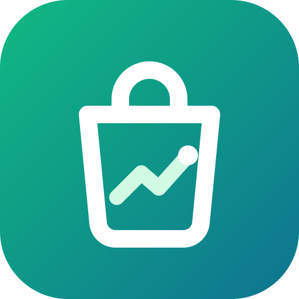

# SanoGestion

### La gestión de tu tienda, clara y en orden

Punto de venta, inventario, caja en **dólares y bolívares**, fiados y reportes para tiendas y bodegas.<br>
Multisede, instalable en cualquier dispositivo y funciona aunque se vaya el internet.

[](https://sano-gestion.web.app)
[](https://sano-gestion.web.app)
[](https://wa.me/584221906045?text=Hola%2C%20quiero%20SanoGestion%20para%20mi%20negocio)


<br>

<a href="https://sano-gestion.web.app">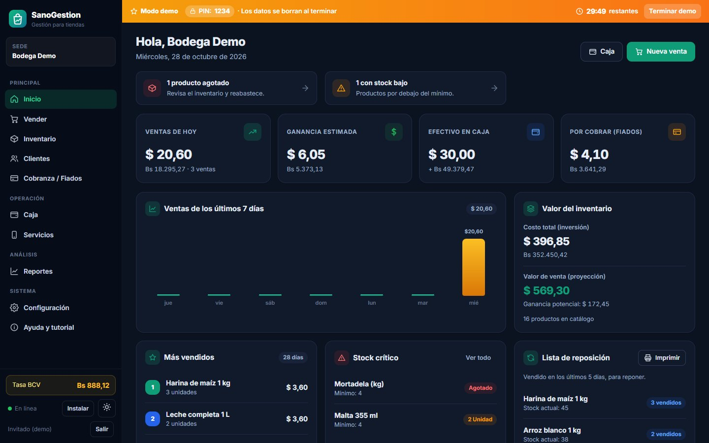</a>

</div>

---

## ✨ ¿Qué es SanoGestion?

SanoGestion es un sistema web para manejar el día a día de una tienda, bodega o abasto en Venezuela: **vender rápido, saber qué hay en el inventario, cuadrar la caja en $ y Bs y llevar los fiados al día**. Cada sede tiene su propia cuenta y sus datos aislados, y un panel de administrador permite ver y gestionar todas las sedes desde un solo lugar.

> [!TIP]
> **Pruébalo sin registrarte:** en la pantalla de inicio toca **“Probar demo gratis”**. Tendrás 30 minutos con una tienda de ejemplo y un **recorrido guiado** por cada sección. El PIN de la demo es **1234**. Al terminar, todo se borra solo.

## 🧩 Funciones

<table>
<tr>
<td width="50%" valign="top">

### 🛒 Punto de venta
- Búsqueda por nombre o **lector de código de barras**
- Hasta **3 listas de precios** (detal, mayor…)
- Venta por unidad o por **bulto**
- Descuentos en % o monto y ventas **en espera**
- **Pagos mixtos**: efectivo $, efectivo Bs, punto, pago móvil, transferencia, Biopago, Zelle
- **Vuelto** en la moneda que elijas
- **Abono parcial** y el resto fiado
- Recibo térmico 58/80 mm o carta

</td>
<td width="50%" valign="top">

### 📦 Inventario
- Costo por unidad o por bulto, en $ o Bs
- Margen y precio en Bs con la **tasa BCV del día**
- Alertas de **stock bajo** y agotados
- Entradas de mercancía, mermas y conteo físico
- Historial de movimientos por producto
- Importar y exportar **CSV / Excel**
- Subir precios en masa por categoría

</td>
</tr>
<tr>
<td valign="top">

### 💵 Caja por turnos
- Apertura con fondo en **$ y Bs por separado**
- Ingresos, gastos y retiros
- **Arqueo al cierre**: te dice si sobra o falta
- Reporte de cierre imprimible
- Historial de turnos anteriores

</td>
<td valign="top">

### 🤝 Clientes y fiados
- Ficha de cliente con compras, deudas y abonos
- Límite de crédito y días de vencimiento
- Abonos en $ o Bs, total o parcial
- **Recordatorio por WhatsApp** con un toque

</td>
</tr>
<tr>
<td valign="top">

### 📊 Reportes
- Ventas, ganancia y métodos de pago
- Filtros por fecha, cliente y tipo
- Gráfico de los últimos 7 días
- Ventas anuladas (devuelven el stock y ajustan la caja)
- Exportación a Excel y PDF

</td>
<td valign="top">

### 📱 Servicios y más
- Recargas telefónicas y avances de efectivo con comisión
- **PIN de datos sensibles** para reportes, anulaciones y cierres
- Copia de seguridad y restauración
- Tema claro / oscuro
- **Ayuda integrada**: video tutorial y 5 recorridos guiados

</td>
</tr>
<tr>
<td valign="top">

### 🏢 Multisede
- Cada sede con su usuario, contraseña y datos aislados
- Panel de administrador: crear, renombrar, suspender y entrar a cada sede
- Varias demos a la vez, cada una independiente

</td>
<td valign="top">

### ⚡ Instalable y sin conexión
- Se instala como app en Android, iPhone y PC
- Sigue funcionando sin internet y sincroniza al volver
- Accesos directos: Vender, Inventario, Caja, Fiados

</td>
</tr>
</table>

## 🖼️ Capturas

<div align="center">

| Punto de venta | Inventario |
|:---:|:---:|
| 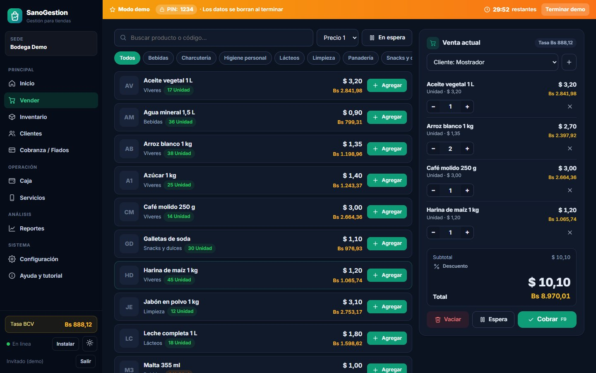 | 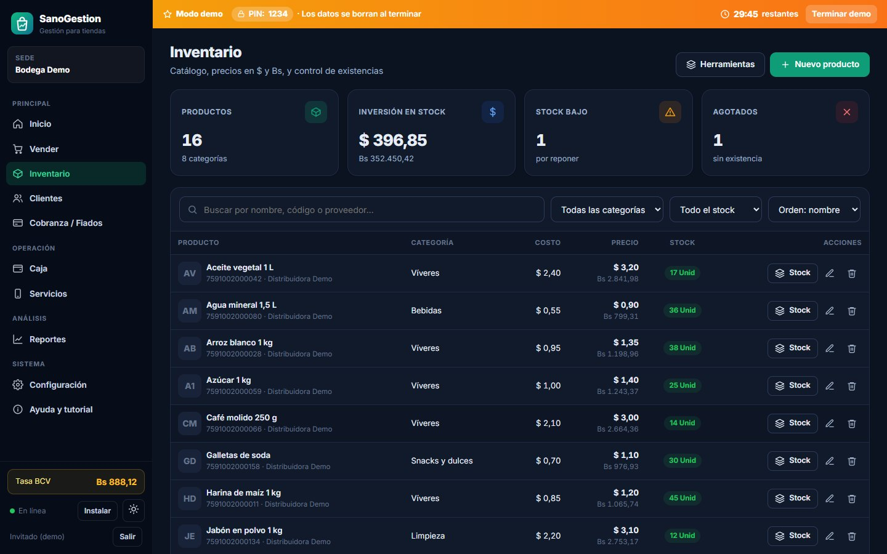 |
| **Caja con arqueo en $ y Bs** | **Cobranza y fiados** |
| 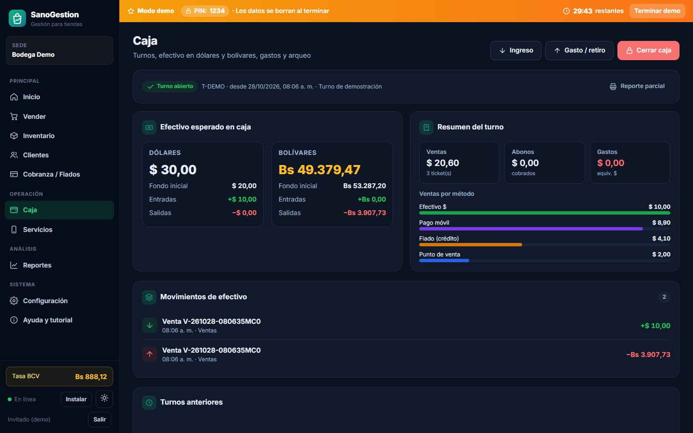 | 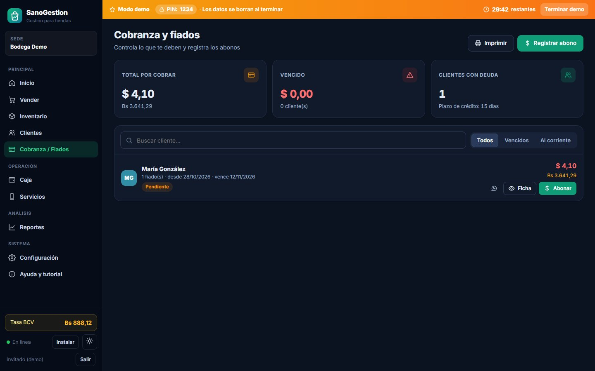 |
| **Recorrido guiado** | **Inicio de sesión y demo** |
| 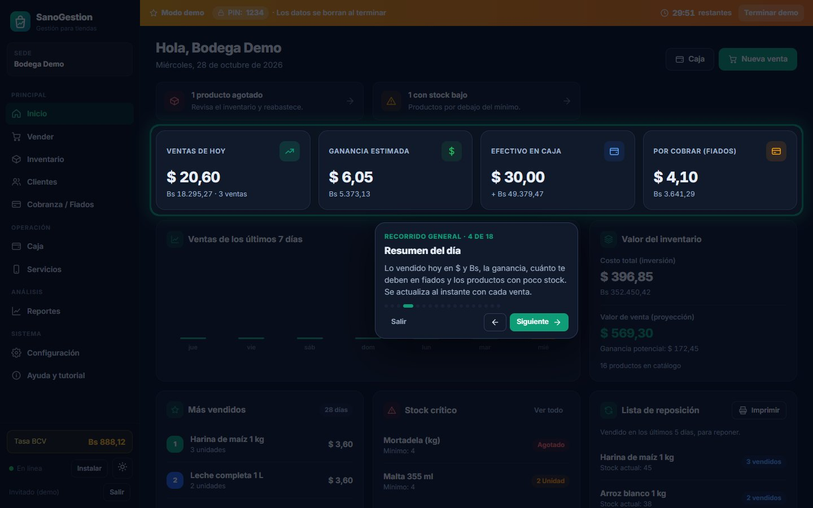 | 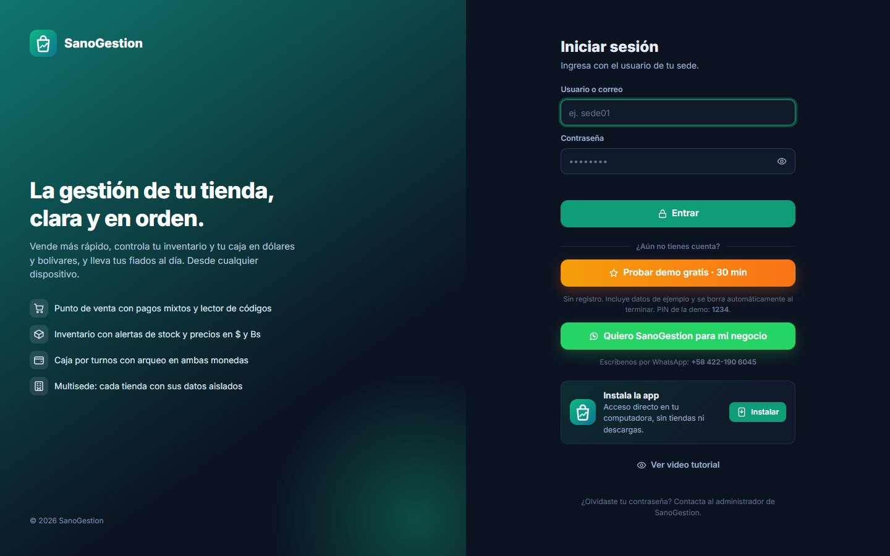 |

### En el teléfono

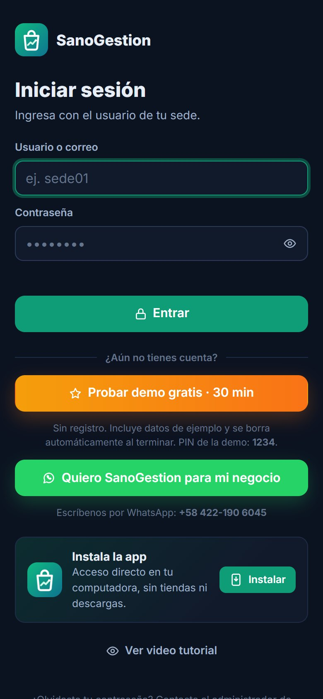&nbsp;
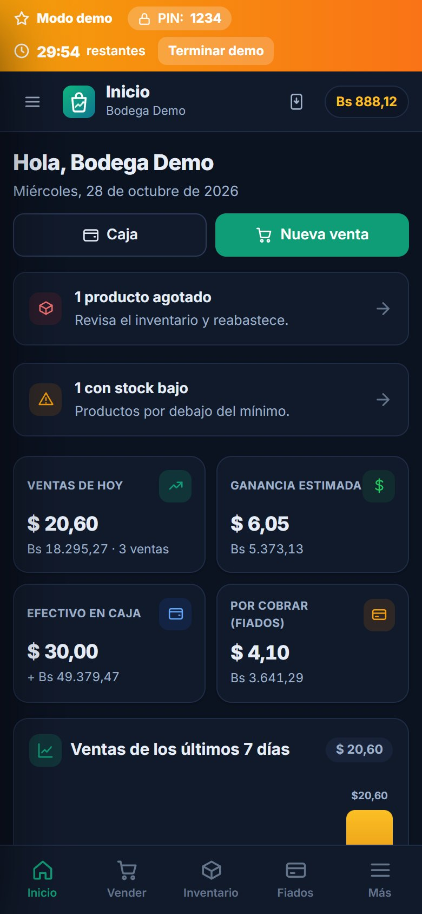&nbsp;
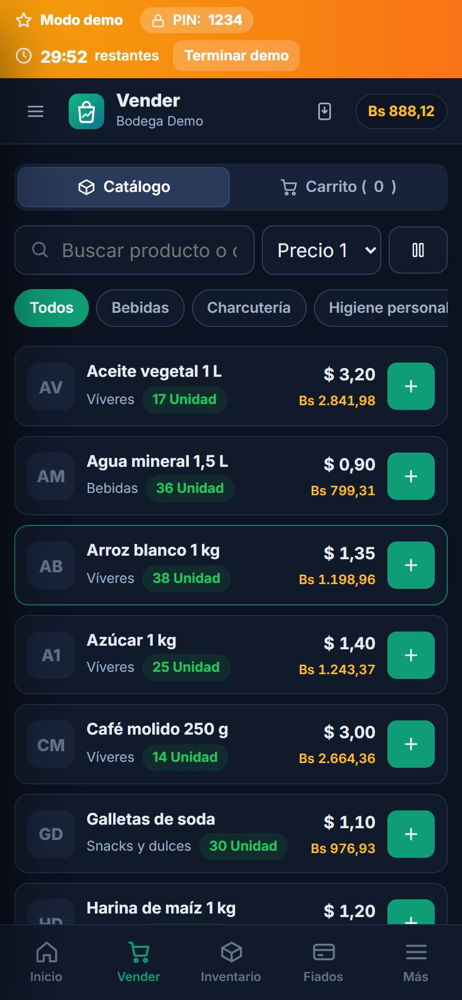&nbsp;
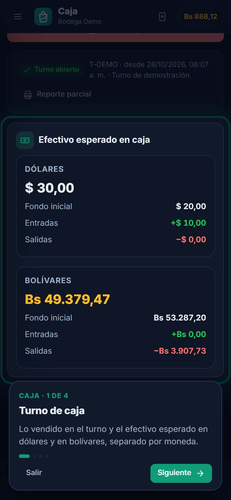

</div>

## 🎬 Video tutorial

<div align="center">
<a href="public/tutorial/sanogestion-tutorial.mp4">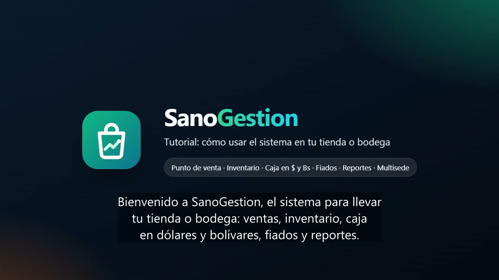</a>

**6 minutos narrados** con todas las funciones: [ver el video](public/tutorial/sanogestion-tutorial.mp4) · también disponible dentro de la app en **Ayuda y tutorial**.
</div>

## 🛠️ Tecnología

| Capa | Herramienta |
|---|---|
| Interfaz | HTML + CSS + **JavaScript puro** (módulos ES, sin compilar) |
| Datos | **Cloud Firestore** en tiempo real con caché sin conexión |
| Cuentas | **Firebase Authentication** (correo/contraseña y anónimo para la demo) |
| Publicación | **Firebase Hosting** |
| App | **PWA**: service worker, manifest e instalación en cualquier equipo |
| Tasa | Tasa BCV automática ([ve.dolarapi.com](https://ve.dolarapi.com)) |
| Pruebas | Emuladores de Firebase + Puppeteer |

Las operaciones de dinero (venta, anulación, abono, caja y stock) se guardan en **lotes atómicos**: todo se registra junto o nada, incluso sin conexión. Las reglas de Firestore aíslan cada sede y bloquean la escritura de las demos vencidas.

## 📁 Estructura

```
SanoGestion/
├── public/                    Sitio publicado en Firebase Hosting
│   ├── index.html · sw.js · manifest.webmanifest
│   ├── css/app.css            Diseño (tema claro y oscuro, adaptable a móvil)
│   ├── js/
│   │   ├── main.js            Arranque, login, menú, navegación y ayuda
│   │   ├── firebase.js        Conexión con Firebase
│   │   ├── store.js           Datos en vivo por sede (tenants/{uid}/…)
│   │   ├── ops.js             Operaciones atómicas: venta, anulación, abonos, caja, stock
│   │   ├── demo.js            Demo de 30 minutos con datos de ejemplo
│   │   ├── tour.js            Recorridos guiados
│   │   ├── install.js         Botón de instalar la app
│   │   └── views/             Inicio, Vender, Inventario, Clientes, Cobranza,
│   │                          Caja, Servicios, Reportes, Configuración, Admin
│   └── tutorial/              Video tutorial
├── firestore.rules            Seguridad: aislamiento por sede y administrador
├── firestore.indexes.json
├── firebase.json
├── marketing/                 Flyers para redes sociales
├── docs/img/                  Capturas de este README
└── scripts/
    ├── provision.mjs          Crea las cuentas de las sedes
    ├── tests/                 Pruebas automáticas
    └── tutorial/              Generador del video tutorial
```

## 🚀 Instalación y despliegue

Requisitos: [Node.js](https://nodejs.org) 18+ y [Firebase CLI](https://firebase.google.com/docs/cli) (`npm i -g firebase-tools`).

```bash
git clone https://github.com/coxc4418-hue/SanoGestion.git
cd SanoGestion
firebase login

# Probar en local con emuladores (abrir http://127.0.0.1:5055/?emu=1)
firebase emulators:start --only auth,firestore,hosting

# Publicar
firebase deploy --only hosting      # la app
firebase deploy --only firestore    # reglas e índices
firebase deploy --only auth         # habilita correo/contraseña y anónimo
```

Para usar otro proyecto de Firebase, cambia las claves en `public/js/firebase.js` y el proyecto en `.firebaserc`.

### Crear sedes

```bash
cd scripts && npm install
node provision.mjs 20               # crea sede01…sede20 y la cuenta de administrador
```

También se crean desde el **panel de administrador** con usuario, correo y contraseña.

> [!IMPORTANT]
> Las contraseñas generadas se guardan en `CREDENCIALES_SANOGESTION.txt` y `scripts/.accounts.json`. Están excluidas del repositorio en `.gitignore`: no las subas ni las compartas.

## ✅ Pruebas

| Prueba | Qué revisa | Comando |
|---|---|---|
| General | 85 verificaciones: inventario, ventas, pagos mixtos, vueltos, fiados, caja, servicios, reportes, configuración, admin y demo | `bash scripts/tests/run-emu.sh` |
| Recorrido guiado | 826 verificaciones en PC, tablet, iPhone y Android | `bash scripts/tests/run-emu.sh tour.mjs` |
| Producción | Recorrido y demo en el sitio publicado | `node scripts/tests/tour-prod.mjs` |

El video tutorial se regenera con `node scripts/tutorial/make-video.mjs` (emuladores encendidos, `ffmpeg` y `pip install edge-tts`).

## 📝 Versiones

| Versión | Novedades |
|---|---|
| **1.4** | Recorrido guiado al entrar a la demo y 5 recorridos en Ayuda |
| **1.3** | PIN 1234 en demos, Ayuda con video tutorial, botón Instalar app, prueba general |
| **1.2** | Optimización completa para teléfonos (sin scroll lateral, tablas en tarjetas) |
| **1.1** | Crear sedes desde el panel admin, demo de 30 minutos, flyers |
| **1.0** | Migración a Firebase y renovación completa del sistema |

---

<div align="center">

### ¿Quieres SanoGestion para tu negocio?

[](https://wa.me/584221906045?text=Hola%2C%20quiero%20SanoGestion%20para%20mi%20negocio)

**[sano-gestion.web.app](https://sano-gestion.web.app)**

© 2026 SanoGestion · Todos los derechos reservados

</div>
